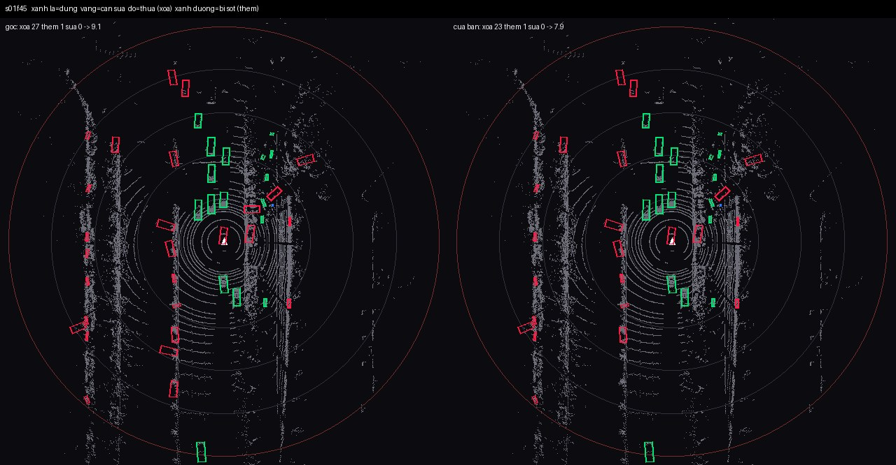

# Báo cáo Day 14 — Nguyễn Đức Anh — 2A202603209

> Sao chép file này thành `report/individual/<MSSV>_<HoTen>.md` (không dấu), ví dụ `2A20260000_NguyenVanAn.md`.

- Mã học viên dùng với `--student`: `209`
- `seed_tag` trong `frames_A.txt`: `0d038e9b72`

## 1. Dự đoán trước sweep (bước 5b)

Ghi **trước** khi chạy `scripts/pp_sweep.py`, rồi commit và push ngay (lịch sử commit là bằng chứng thời điểm viết). Không sửa phần này sau khi có kết quả.

- Tham số tôi nghĩ giảm công sửa nhiều nhất: `score_thr`
- Vì sao (nhìn ảnh BEV tập A: box thừa nhiều hay box sót nhiều?): Tăng `score_thr` từ mức gốc `0.1` lên ngưỡng cao hơn có thể lọc các box dự đoán yếu ở mép đường, lan can, hàng cây và vật thể xa. Trong ảnh BEV/7 camera của tập A, số box thừa rõ ràng nhiều hơn số box thật bị sót, nên giảm số box thừa bằng cách tăng độ tin cậy tối thiểu sẽ có khả năng giảm công sửa thêm nhiều nhất.

## 2. Tập A: sửa tay và tune

| Cấu hình | Xóa | Thêm | Sửa | Chi phí |
|---|---:|---:|---:|---:|
| Gốc | 41 | 3 | 0 | 15.3 |
| `best_config.json` | 34 | 3 | 0 | 13.2 |

- Tham số đã đổi trong `best_config.json`: `score_thr` tăng từ `0.1` lên `0.3`; các tham số còn lại giữ nguyên.
- Kết quả leave-one-out (dán nguyên các dòng `scripts/pp_sweep.py` in ra):

```text
  s01f45: cấu hình chọn {'score_thr': '0.3', 'min_points': '0'} → 7.9 (tốt nhất có thể 7.6)
  s02f13: cấu hình chọn {'score_thr': '0.3', 'min_points': '0'} → 3.1 (tốt nhất có thể 3.1)
  s03f09: cấu hình chọn {'score_thr': '0.3', 'min_points': '0'} → 2.2 (tốt nhất có thể 2.2)
```

- Cấu hình được chọn khá ổn định trong leave-one-out: cả ba lần đều chọn `score_thr=0.3, min_points=0`. Chi phí trên frame giữ lại lần lượt là 7.9, 3.1 và 2.2; riêng `s01f45` còn cách mức tốt nhất có thể 0.3. Dù vậy, chỉ có ba frame tune nên kết quả này chưa bảo đảm tổng quát cho mọi frame.

## 3. Trước/sau (bước 8)



- `scripts/pp_compare.py` báo giảm 14% công sửa trên tập A: chi phí tổng từ 15.3 xuống 13.2.
- Dự đoán ở mục 1 đúng theo hướng tổng quát: tăng `score_thr` giúp giảm box thừa. Số box cần xóa giảm từ 41 xuống 34, trong khi số cần thêm giữ nguyên 3 và số cần sửa giữ nguyên 0. Kết quả phù hợp với dự đoán ưu tiên lọc box thừa.

## 4. Tập B

Số đo từ `scripts/pp_prelabel.py --frames d14_209/frames_B.txt --config d14_209/best_config.json --gt d14_209/ref_B.json`:

| Xóa | Thêm | Sửa | Chi phí |
|---:|---:|---:|---:|
| 127 | 19 | 2 | 58.1 |

- Phần công lớn nhất là xóa box thừa: 127 box, tương đương 38.1 điểm chi phí; thêm 19 box tương đương 19 điểm và sửa 2 box tương đương 1 điểm. Output của script không chia các thao tác này theo class, nên chưa thể kết luận class nào tốn công nhất.

```text
frame     box  lớp
s01f13     20  {'Car': 16, 'Cyclist': 3, 'Pedestrian': 1}  cảnh báo kích thước=1  3.3s  | xóa 12 thêm 2 sửa 0 → chi phí 5.6
s01f35     22  {'Car': 13, 'Cyclist': 6, 'Pedestrian': 3}  cảnh báo kích thước=0  3.1s  | xóa 11 thêm 2 sửa 0 → chi phí 5.3
s01f58     29  {'Car': 16, 'Cyclist': 12, 'Pedestrian': 1}  cảnh báo kích thước=1  3.0s  | xóa 13 thêm 1 sửa 0 → chi phí 4.9
s03f02     20  {'Car': 19, 'Cyclist': 1}  cảnh báo kích thước=0  3.0s  | xóa 8 thêm 2 sửa 0 → chi phí 4.4
s03f40     16  {'Car': 10, 'Cyclist': 5, 'Pedestrian': 1}  cảnh báo kích thước=0  3.4s  | xóa 12 thêm 1 sửa 0 → chi phí 4.6
s03f56     27  {'Car': 19, 'Cyclist': 8}  cảnh báo kích thước=0  4.2s  | xóa 13 thêm 3 sửa 0 → chi phí 6.9
s04f01     25  {'Car': 24, 'Cyclist': 1}  cảnh báo kích thước=2  3.5s  | xóa 5 thêm 5 sửa 0 → chi phí 6.5
s04f33     17  {'Car': 16, 'Cyclist': 1}  cảnh báo kích thước=1  3.5s  | xóa 6 thêm 1 sửa 1 → chi phí 3.3
s04f56     10  {'Car': 10}  cảnh báo kích thước=0  3.1s  | xóa 3 thêm 0 sửa 0 → chi phí 0.9
s05f03     32  {'Car': 25, 'Cyclist': 6, 'Pedestrian': 1}  cảnh báo kích thước=0  3.4s  | xóa 19 thêm 0 sửa 1 → chi phí 6.2
s05f27     30  {'Car': 27, 'Cyclist': 3}  cảnh báo kích thước=0  3.5s  | xóa 15 thêm 1 sửa 0 → chi phí 5.5
s05f46     20  {'Car': 11, 'Cyclist': 9}  cảnh báo kích thước=0  2.8s  | xóa 10 thêm 1 sửa 0 → chi phí 4.0
TỔNG (12 frame có nhãn): GT 160, dự đoán 268, khớp 141, xóa 127, thêm 19, sửa 2 → chi phí 58.1
```

## 5. Giới hạn

- Tập tune A chỉ có 3 frame; kết quả sweep và leave-one-out ít dữ liệu nên có thể không đại diện cho các tình huống khác ở tập B.
- PointPillars được huấn luyện trên KITTI, không có class Truck/Bus; các class này phải được xử lý bằng luật hậu xử lý, còn Pedestrian/Cyclist có thể bị bỏ sót.
- Chi phí dùng công thức `0.3 × xóa + 1.0 × thêm + 0.5 × sửa`, không phải thời gian thao tác đo trực tiếp. Số đo chỉ tính vật thể có tâm trong phạm vi 50 m.
